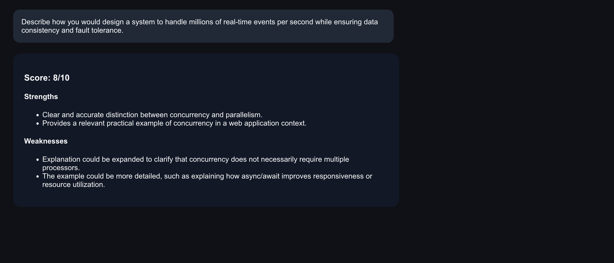
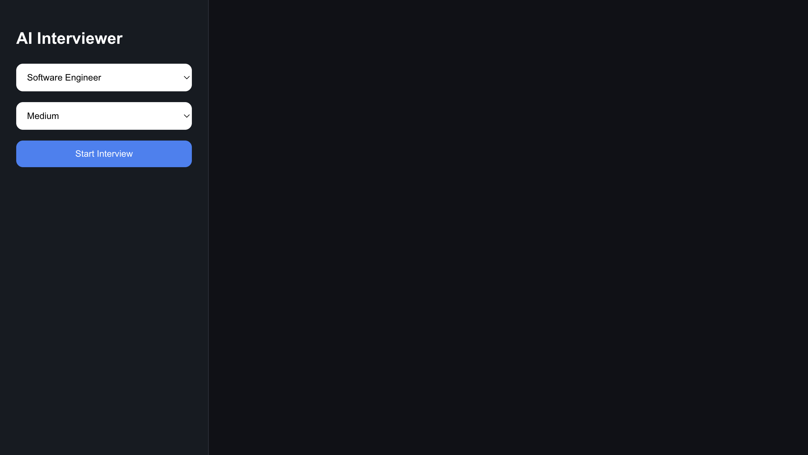
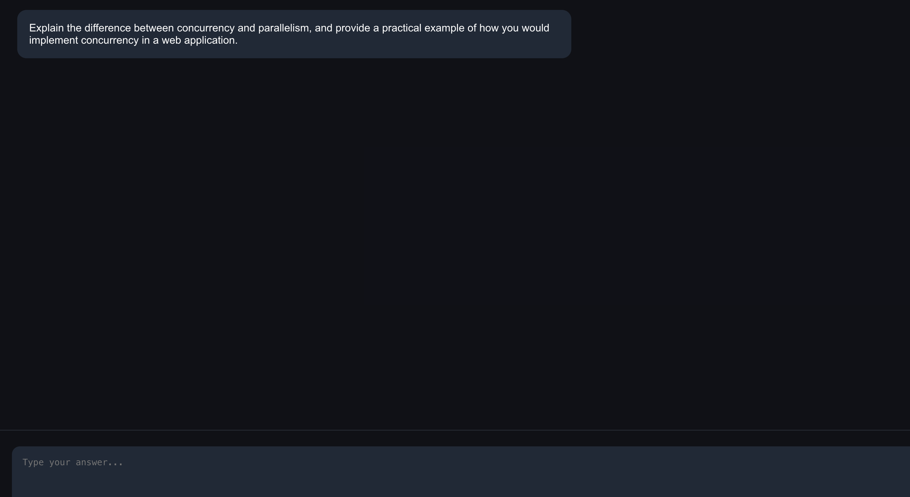
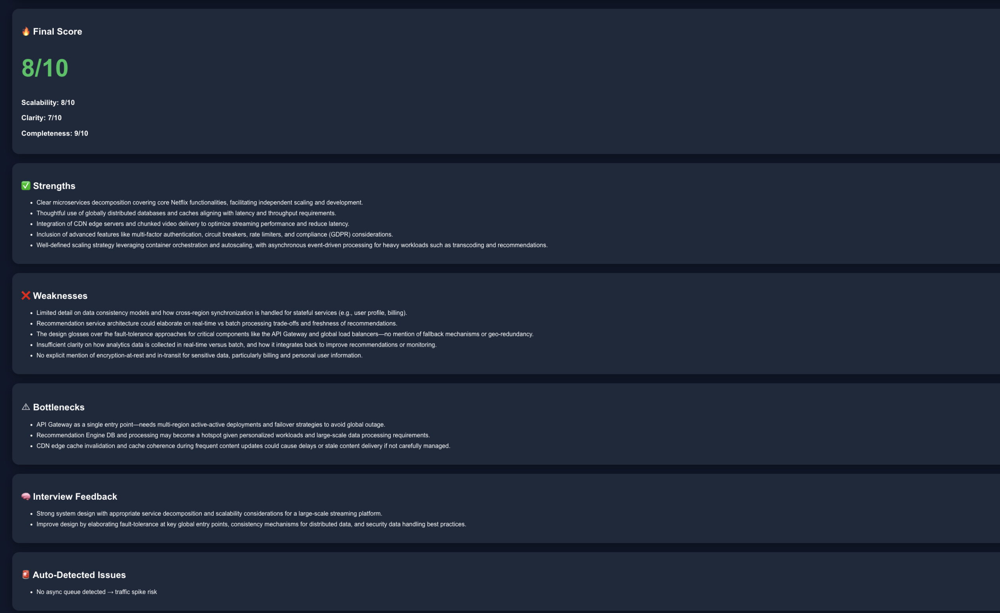

# InterviewForge

 · [MIT License](LICENSE)

**Practice technical interviews that build on your answers—and pressure-test your system designs with structured engineering feedback.**

InterviewForge unifies two projects into one local-first React + FastAPI application: an **Interview Room** with multi-round contextual follow-ups and SQLite-backed progress, and a **System Design Lab** for generating visual architectures and reviewing candidate-written designs.

> **Screenshot provenance:** All six images below are genuine screenshots from the **two earlier prototype repositories**, preserved here as historical examples. They do **not** depict the new unified InterviewForge UI. A verified recording of the new UI is still on the roadmap.

  
  

Historical prototype examples: answer evaluation and distributed architecture visualization.

## Why InterviewForge?

Generic AI chat can produce questions, but practice needs a repeatable feedback loop. InterviewForge stores actual answers and evaluations, identifies recent weak spots, and passes those weak spots into the **next** question. The system design side also distinguishes a **candidate-authored architecture** from an AI-generated reference—so the tool can critique *your choices*, instead of simply grading its own output.

The application is an interview **practice tool**, not a validated predictor of hiring decisions.

## Explore the two workflows

### 1. Interview Room — question → answer → feedback → follow-up

Choose a role, difficulty (**Easy / Medium / Hard**), and engineering focus (**backend, frontend, systems, ML or general**). The platform generates one question, evaluates the answer, and uses the past few rounds to target subsequent questions.

- **Structured evaluation:** Ratings for technical accuracy, reasoning, engineering trade-offs, and communication clarity, with specific strengths, improvements, and weak spots.
- **Multi-round context:** The latest questions, answers, scores, and weak spots are included when producing the next challenge. This is contextual prompting, not a trained personalization model.
- **Durable sessions:** SQLite stores the active question and completed rounds. The browser remembers the last session ID so that session can be resumed after restarting the app.
- **Progress:** Completed round count, average score, recent average, and recurring weaknesses. Finish the interview when you're done.

**Earlier Technical Interview Simulator — home and role selection**

**Earlier prototype — actual interview question**

The captured question asked how **concurrency differs from parallelism**, including an example in a web application. The earlier interface subsequently displayed feedback with a **score of 8/10**, noting a useful concurrency example while suggesting a more detailed explanation of asynchronous execution:

**Important:** The results screenshot shows the *following* question about real-time event processing above feedback from the *previous* concurrency answer. This is evidence of the earlier prototype's interface, not a captured session in today's application.

### 2. System Design Lab — prompt → architecture → diagram → review

Try prompts such as **Design Netflix**, Instagram, Uber, WhatsApp, a URL shortener, a distributed cache, or your own engineering challenge. InterviewForge generates a reference architecture consisting of services, data stores, APIs, caching layers, scaling choices, assumptions and explicit trade-offs.

You can enter **your proposed architecture** alongside the prompt. The reviewer will then evaluate **your design**. If no proposed design is provided, it reviews the generated reference and labels that distinction. Diagram source is rendered using Mermaid.js.

**Earlier System Design Simulator — prompt and summary**

**Earlier prototype — Netflix architecture and engineering notes**

This Mermaid diagram is a **transcription** of visible connections in that earlier screenshot, not the original model response:

~~~mermaid
flowchart TD
  Streaming[Video Streaming Service] --> CDN[CDN]
  CDN --> User[User]
  User --> Gateway[API Gateway]
  Gateway --> Auth[Auth Service]
  Gateway --> Catalog[Content Catalog Service]
  Gateway --> Recs[Recommendation Service]
  Gateway --> Billing[Billing Service]
  Catalog --> Metadata[(Content Metadata DB)]
  Recs --> RecDB[(Recommendation DB)]
  Transcode[Transcoding Service] --> Storage[(Content Storage)]
  Analytics[Analytics Service] --> AnalyticsDB[(Analytics DB)]
~~~

**Earlier prototype — real architecture evaluation**

| Category | Captured earlier score |
| --- | ---: |
| Overall | **8/10** |
| Scalability | 8/10 |
| Clarity | 7/10 |
| Completeness | 9/10 |

The captured critique warned that a single API gateway might be a failure point and suggested multi-region failover. A separate rule-based warning read **“No async queue detected → traffic spike risk.”** These are genuine **earlier** results; InterviewForge now uses a different four-dimension design rubric.

*Illustrative interview follow-up, not captured output:* “If the API gateway region fails, how would you keep incoming requests available?”

## How it works

### Interview session flow

~~~mermaid
flowchart TD
  Setup[Role + track + difficulty] --> Question[Generate question]
  Question --> Answer[Submit candidate answer]
  Answer --> Evaluation[Pydantic-validated AI evaluation]
  Evaluation --> Score[Calculate weighted score]
  Score --> Stored[(Save round in SQLite)]
  Evaluation --> Weak[Identify weak spots]
  Weak --> Next[Generate follow-up using recent history]
  Stored --> Next
  Next --> Answer
~~~

### System design flow

~~~mermaid
flowchart LR
  Prompt[Design prompt] --> Reference[Generate reference architecture]
  Reference --> Mermaid[Render Mermaid diagram]
  Candidate[Optional candidate-written architecture] --> Review[Choose review target]
  Reference --> Review
  Review --> Scores[AI rubric and feedback]
  Review --> Hints[Keyword-based hints]
  Scores --> DB[(SQLite)]
  Hints --> DB
~~~

### Key engineering decisions

| Capability | Implementation |
| --- | --- |
| AI orchestration | OpenAI API, default **GPT-4.1-mini**, with distinct question, evaluation, architecture and review prompts |
| Typed outputs | OpenAI structured parsing into Pydantic response models and bounded scoring values |
| Persistence | SQLite tables for sessions, interview rounds, and design artifacts; data survives app restarts |
| Contextual follow-ups | Recent answer history and weak spots passed into each next-question prompt |
| Duplicate submission protection | Optimistic session-version comparison, plus a transactional round update |
| Score transparency | Four dimensions combined using published deterministic weights |
| Architecture review | Prioritizes candidate-written design, if provided; otherwise labels the generated reference |
| Bottleneck detection | Explicit **regex keyword checks**, not semantic graph verification |
| Automated tests | Pytest / FastAPI TestClient with an injectable fake AI provider, requiring no paid model calls |

**Scoring formulas**

- **Technical interviews:** 35% accuracy + 30% reasoning + 20% trade-offs + 15% clarity.
- **System designs:** 35% scalability + 25% reliability + 25% trade-offs + 15% clarity.

For example, interview ratings **8 / 7 / 6 / 9** produce a weighted **7.5/10**. The arithmetic is reproducible; the *model-assigned ratings are subjective and have not been calibrated against real interviewers.*

**Bottleneck checks** flag absent mentions of caching, load balancing, replication/failover, CDN and asynchronous queues. They can misfire: “no caching” still mentions caching, so this is a prompt for discussion rather than a confirmed missing component.

### Example multi-round transcript (test fixture, not live AI output)

~~~text
Role: Backend Engineer
Track: backend
Difficulty: Medium

Round 1: How would you improve API design in a backend service?
Candidate: I would add an API gateway and cache.

Evaluation:
  Accuracy 8  | Reasoning 7 | Trade-offs 6 | Clarity 9
  Weighted score: 7.5/10
  Identified weak spot: caching

Round 2: How would you improve Caching in a backend service?
  The completed first round and feedback remain in SQLite.
~~~

This example reflects a **deterministic fake-model test** in the repository. The real AI provider generates different questions and feedback from actual user responses.

## Quick start

**Prerequisites:** Python **3.11+**, Node.js **20+**, npm, Git, and an OpenAI API key for live AI interactions. **API requests may incur charges** separate from your ChatGPT subscription. There is no hosted demo yet.

**Terminal 1 — backend**

~~~bash
git clone https://github.com/vihaank1/InterviewForge.git
cd InterviewForge/backend

python3 -m venv .venv
source .venv/bin/activate
python -m pip install -r requirements.txt

cp .env.example .env
# Set OPENAI_API_KEY in backend/.env
python -m uvicorn app.main:app --reload --port 8000
~~~

Windows users can activate with \`.venv\\Scripts\\activate\` and copy the environment file using \`copy .env.example .env\`. Backend docs: **http://127.0.0.1:8000/docs**.

**Terminal 2 — frontend**, starting from the repository root:

~~~bash
cd frontend
npm install
cp .env.example .env
npm run dev
~~~

Open **http://127.0.0.1:5173**. The frontend connects to \`http://127.0.0.1:8000\` by default using \`VITE_API_URL\`. **Never expose an OpenAI key in frontend variables**; configure it only in the backend.

**Test locally (no API key needed)**

~~~bash
cd backend
python -m pip install -r requirements-dev.txt
python -m pytest -q
~~~

**Build the frontend**

~~~bash
cd frontend
npm install
npm run build
~~~

GitHub Actions runs backend tests and a frontend build automatically: [view CI](https://github.com/vihaank1/InterviewForge/actions).

## Technology and repository organization

| Layer | Technologies |
| --- | --- |
| Frontend | React, Vite |
| Diagrams | Mermaid.js |
| Backend | Python, FastAPI |
| Validation | Pydantic |
| AI | OpenAI API (GPT-4.1-mini by default) |
| Persistence | SQLite with WAL |
| Verification | Pytest, TestClient, GitHub Actions |

The most important files show the system boundaries:

- [\`backend/app/ai.py\`](backend/app/ai.py) — prompts and typed model responses.
- [\`backend/app/main.py\`](backend/app/main.py) — HTTP routes and application lifecycle.
- [\`backend/app/database.py\`](backend/app/database.py) — database schema and connections.
- [\`backend/app/scoring.py\`](backend/app/scoring.py) — scoring weights, progress metrics and heuristic checks.
- [\`backend/app/schemas.py\`](backend/app/schemas.py) — Pydantic data contracts.
- [\`frontend/src/\`](frontend/src) — interview and architecture UI.
- [\`docs/ARCHITECTURE.md\`](docs/ARCHITECTURE.md) — API endpoints, storage lifecycle and architectural trade-offs.

## Limitations and what comes next

- **The six screenshots are older prototype UI captures**, not a demonstration of the rebuilt React application. A real video/GIF of the current app is still needed.
- AI evaluation scores are not validated against human interviewers or employment decisions.
- SQLite persistence is local; there is **no user authentication, tenant isolation, hosted storage or rate limiting**. Don't expose this prototype to public traffic without hardening it.
- Keyword warnings can miss real engineering problems or flag valid choices. Mermaid diagrams may fail if the model produces invalid syntax.
- Submitted answers are stored locally and sent to the configured OpenAI provider; do not enter secrets or confidential content.
- An answer requires separate model calls for scoring and for the next question, increasing latency and API cost.

### Focused roadmap

- [x] Consolidate two interview projects into one codebase
- [x] Add SQLite-backed sessions, typed AI outputs, rubrics, and testable API boundaries
- [x] Restore six historical prototype screenshots and actual earlier examples
- [ ] Record a genuine current-UI prompt → answer → feedback → follow-up GIF
- [ ] Add browsable session history and cross-session progress reports
- [ ] Add auth, isolation and rate limiting before deployment

## Origins, contributing and license

InterviewForge consolidates the ideas behind the [System Design Simulator](https://github.com/vihaank1/System-Design-Simulator) and [AI Technical Interview Simulator](https://github.com/vihaank1/technical-interview-simulator). **Both original repositories are preserved.** The images in \`assets/legacy/\` are unchanged WebP source files retrieved from those repositories (whose original file extensions were \`.png\`).

See [CONTRIBUTING.md](CONTRIBUTING.md) for contribution guidance. Licensed under the [MIT License](LICENSE). Not affiliated with any employer or interview program.
