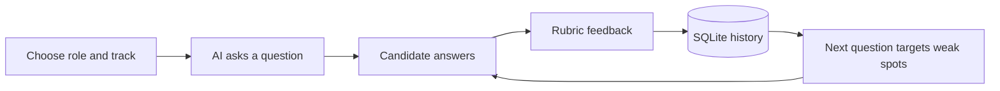
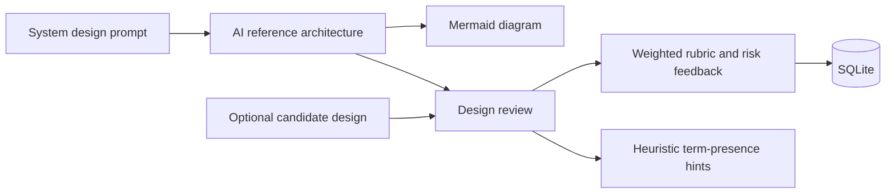

# InterviewForge

**Practice technical interviews with follow-up questions based on your actual answers—and stress-test your system designs against a reference architecture.**

InterviewForge combines two complementary workflows in one React + FastAPI app: an **interview room** that remembers what you said and probes recent weak spots, and a **system design studio** that generates diagrams and evaluates *your own* design when you provide one. Sessions and evaluations survive backend restarts in local SQLite storage.

> **Status:** Local-first portfolio project. The backend's automated API tests pass. A full live OpenAI session and a frontend production build have **not** been verified in this environment; you will need an API key and normal npm registry access. Do not treat generated feedback as a hiring prediction.

## Why use this instead of a single chat prompt?

- **Multi-round context:** Subsequent prompts include recent questions, your answers, and identified weak spots instead of starting from scratch each time.
- **Recoverable practice:** Session IDs, answer history, feedback, and weighted scores are stored in SQLite. The browser remembers your latest session ID for local resume.
- **Two sides of system design:** Generate a learning reference, but optionally paste **your design** to receive feedback on *your* trade-offs, not just an LLM grading its own architecture.
- **Inspect the logic:** Pydantic-validated model outputs, an explicit score formula, and plainly labeled keyword-based bottleneck hints.

## Workflows





### What is implemented

| Capability | Implementation |
| --- | --- |
| Multi-round interviewing | Role, difficulty and track selection; answer-scoped evaluation; targeted next question |
| Progress signals | Weighted scores and recent weak spots from stored session rounds |
| Durable storage | Local SQLite tables for sessions, rounds and designs; optimistic version check on answer submissions |
| Design reference | Services, databases, caching, APIs, scaling notes, assumptions, trade-offs, and Mermaid diagram |
| Candidate design review | Reviews user-written architecture if provided; otherwise clearly labels the target as the generated reference |
| Input / output validation | Pydantic validation for requests and model responses using OpenAI's structured parse helper |
| Deterministic checks | Simple keyword-presence warnings for caching, load balancing, replication, CDN and queues |
| Automated tests | Unit/API tests with a deterministic fake AI provider, requiring no paid API calls |

### Evaluation formulas

The application calculates weighted values from model-generated per-dimension ratings. The *weights are deterministic*, but the underlying model ratings are **subjective and uncalibrated**.

- **Technical interview:** 35% accuracy + 30% reasoning + 20% trade-offs + 15% clarity.
- **System design:** 35% scalability + 25% reliability + 25% trade-offs + 15% clarity.

Missing-component warnings are regex hints, **not** structural design verification. A phrase such as “no caching” can still count as a mention of caching.

## Quick start

**Prerequisites:** Python **3.11+**, Node.js **20+**, npm, and a valid **OpenAI API key**. API usage is billed separately; your personal ChatGPT subscription does not automatically cover API charges. The default model is `gpt-4.1-mini`. Check the current pricing for your model before running multiple sessions.

**Terminal 1 — backend**

```bash
git clone https://github.com/vihaank1/InterviewForge.git
cd InterviewForge/backend
python3 -m venv .venv
source .venv/bin/activate
python -m pip install -r requirements.txt
cp .env.example .env
# Edit backend/.env and set OPENAI_API_KEY
python -m uvicorn app.main:app --reload --port 8000
```

On Windows, activate the environment with `.venv\Scripts\activate` and copy the environment template with `copy .env.example .env`.

**Terminal 2 — frontend** (from the repository root)

```bash
cd frontend
npm install
cp .env.example .env
npm run dev
```

Open <http://127.0.0.1:5173>. FastAPI docs: <http://127.0.0.1:8000/docs>. The frontend defaults to `http://127.0.0.1:8000` via `VITE_API_URL`.

**Never commit your actual `.env` file or API key.** The repo ignores `.env`, `backend/data/`, virtual environments, and `node_modules/`. The backend allows CORS only from the local frontend origins; change this explicitly if deploying.

### Run tests

```bash
cd backend
python -m pip install -r requirements-dev.txt
python -m pytest -q
```

Frontend build check (requires internet access to install packages):

```bash
cd frontend
npm install
npm run build
```

Once published on GitHub, the included Actions workflow runs backend tests and the frontend production build on pushes and pull requests.

## A short session example

This example illustrates the **tested request flow**, using a fake AI provider from `backend/tests/conftest.py`—**not** a claimed real model transcript:

```text
POST /api/sessions
  role: Backend Engineer, track: backend, difficulty: Medium

Question: How would you improve API design in a backend service?
Candidate: I would add an API gateway and cache.

POST /api/sessions/{id}/answers
  → scored on accuracy, reasoning, trade-offs and clarity
  → one weak spot: caching
  → next question: How would you improve Caching in a backend service?
  → session round: 2; history saved in SQLite
```

For earlier prototype screenshots and historical sample outputs, see the original [System Design Simulator](https://github.com/vihaank1/System-Design-Simulator) and [Technical Interview Simulator](https://github.com/vihaank1/technical-interview-simulator). **Those screenshots represent earlier interfaces, not this new combined UI.** A real end-to-end recording of this interface is still needed.

## How it works

The browser sends typed requests to FastAPI. `app/ai.py` asks `gpt-4.1-mini` for Pydantic-shaped responses using OpenAI's structured parsing API. The server scores the returned dimensions with the explicit weights above and saves evaluated rounds in SQLite. When generating the next question, it supplies **the last few answers and weak spots** as additional context. The generated reference design is stored separately from any candidate-written design.

This implementation uses small, inspectable modules instead of putting the entire app into one file:

- `backend/app/ai.py` — prompts and structured model-output handling.
- `backend/app/main.py` — HTTP endpoints and application state transitions.
- `backend/app/database.py` — SQLite schema and connections.
- `backend/app/scoring.py` — public rubric weights, progress summary, and heuristic detection.
- `backend/app/schemas.py` — Pydantic request and response contracts.
- `frontend/src/` — React interface, API client, and Mermaid renderer.

For endpoint details and architectural decisions, see [docs/ARCHITECTURE.md](docs/ARCHITECTURE.md).

## Current limitations

1. **Not a validated interviewer.** Scores and written feedback come from a language model and have not been calibrated against human interviewers. They can be inconsistent or wrong.
2. **Local prototype, not a multi-user SaaS.** SQLite persists on the local disk, but there is no authentication, per-user isolation, hosted database, rate limiting, or backup process. Never deploy publicly without addressing these.
3. **No live demo yet.** An OpenAI key and network access are necessary for end-to-end AI testing. The automated test suite uses mock responses; the UI has been statically syntax-checked, but its dependency-backed build was not runnable in the offline build environment.
4. **Heuristics aren't architectural proof.** Keyword checks can flag valid designs or miss invalid ones. Mermaid output also depends on model compliance and may occasionally fail to render.
5. **Two model calls per answer.** Evaluation and next-question generation are separate requests, increasing latency and API usage. Failed provider calls leave the previous answer unsubmitted so it can be retried.

## Focused roadmap

- [x] Merge architecture review and multi-round interviews into one interface.
- [x] Add SQLite-backed history and weighted evaluation rubrics.
- [x] Add typed model outputs, automated endpoint tests, and GitHub Actions checks.
- [ ] Capture a real prompt → answer → targeted follow-up → feedback GIF; verify a paid model session end to end.
- [ ] Add local session-list browsing and summary analytics across interviews.
- [ ] Add deployment-ready auth, account boundaries, and API rate limiting.

## Repository status

This standalone repository is published at [vihaank1/InterviewForge](https://github.com/vihaank1/InterviewForge). The original two simulator repositories remain unchanged.

## Contributing

See [CONTRIBUTING.md](CONTRIBUTING.md). Small bug fixes, tests, and clear reproducible issues are welcome.

## License

[MIT](LICENSE). Independent learning tool; not affiliated with any technology company or hiring program.