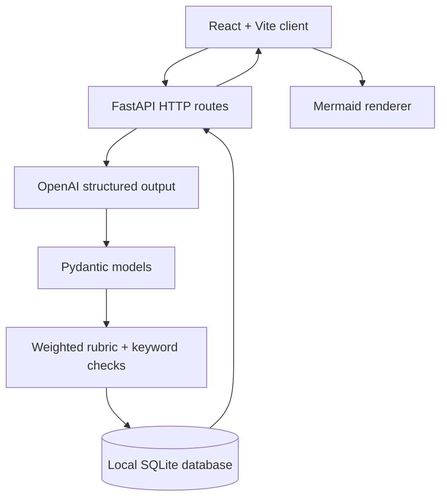

# Implementation notes

## Component flow

### Session lifecycle

1. `POST /api/sessions` validates role, track and difficulty. The model returns a `Question` (`question` and `focus`); the new session is saved to SQLite.
2. `POST /api/sessions/{id}/answers` loads saved history. The model evaluates the actual answer into an `Evaluation` (four bounded 0–10 categories). A deterministic weighted score is calculated.
3. The next question prompt includes recent completed rounds and the current answer plus weak spots. **This is the current form of targeted follow-up**, not retrieval or long-term user profiling.
4. An optimistic `version` comparison prevents duplicated requests from silently advancing the same round twice. The evaluated round is inserted with the version change in a single SQLite transaction.
5. `GET /api/sessions/{id}` exposes saved history and a simple average. `POST /api/sessions/{id}/complete` closes the session.

The backend uses SQLite WAL mode. Reads and writes happen in short-lived connections. The browser caches only the last session ID for convenience. Database entries are not encrypted or associated with authenticated users.

### Design lifecycle

1. `POST /api/designs` validates the prompt, creates a **reference** architecture, and stores it with any candidate-written proposal.
2. `POST /api/designs/{id}/review` evaluates the candidate proposal if supplied; otherwise it evaluates the AI-generated reference **and labels that distinction**.
3. The review has four bounded ratings plus textual advice. Keyword checks separately flag absent *terms*, not confirmed missing components.
4. `GET /api/designs/{id}` retrieves the saved reference and review. The frontend renders the Mermaid source with Mermaid's `securityLevel: strict` setting.

### Endpoint reference

| Method | Path | Purpose |
| --- | --- | --- |
| GET | `/api/health` | Health check |
| POST | `/api/sessions` | Start a multi-round interview |
| GET | `/api/sessions/{id}` | Resume and inspect saved history |
| POST | `/api/sessions/{id}/answers` | Score current answer and generate targeted follow-up |
| POST | `/api/sessions/{id}/complete` | Finish an interview |
| POST | `/api/designs` | Generate and save a design reference |
| GET | `/api/designs/{id}` | Retrieve saved design and review |
| POST | `/api/designs/{id}/review` | Score architecture and return feedback/hints |

### Engineering decisions and trade-offs

- **Provider interface:** `create_app(..., coach=FakeCoach())` allows deterministic HTTP tests without calling or paying OpenAI. The production provider uses `client.beta.chat.completions.parse` to validate response shapes with Pydantic.
- **State:** SQLite avoids standing up a separate database for local users. Missing migrations, backups, isolation and auth make it unsuitable for a public multi-user service in its current form.
- **Scores:** Weighted sums are reproducible; model-provided dimension ratings are unvalidated. This is not an ML scoring benchmark.
- **Concurrency:** Conditional version checks reduce duplicate submission issues. The design review endpoint can be re-run and will overwrite its earlier review.
- **Costs:** Evaluating an answer and creating the next question are separate API calls; a failed call leaves the turn uncommitted rather than storing incomplete feedback.
- **Privacy:** Candidate answers are sent to the configured OpenAI API and stored locally; do not enter secrets or confidential interview content.
